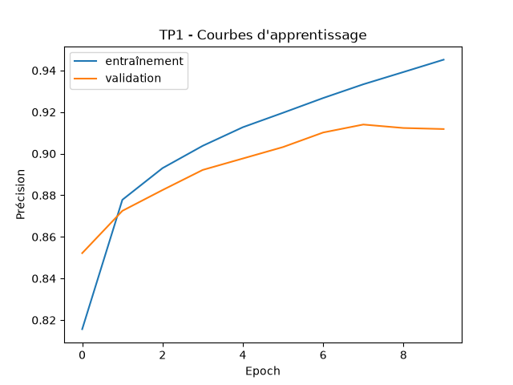
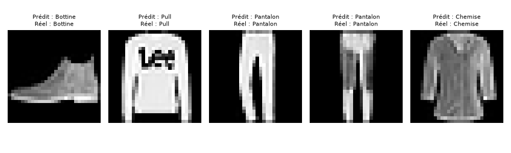
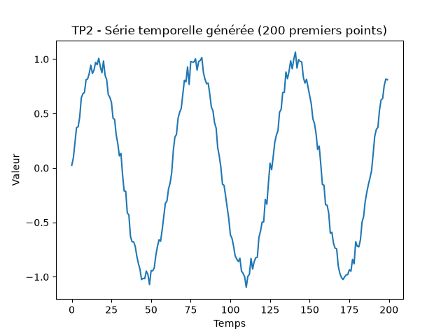
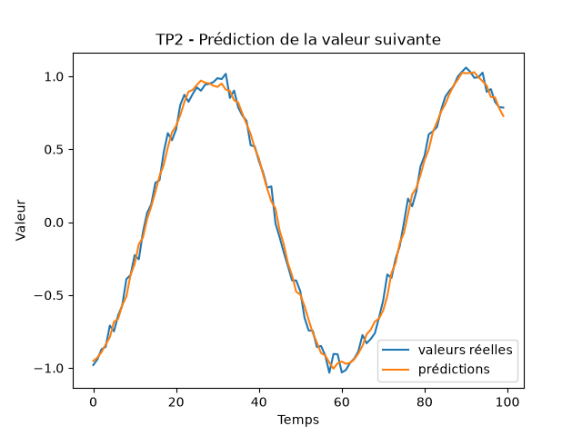
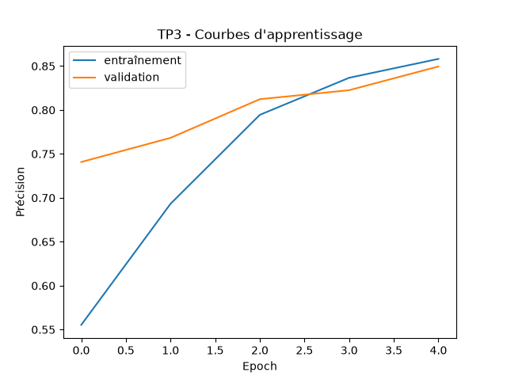

# KABILA KALONDA ALBA 2023023047

## TP1 : CNN, classification d'images (Fashion-MNIST)

**Objectif :** reconnaître 10 catégories de vêtements à partir d'images 28x28 en niveaux de gris.

**Dataset :** Fashion-MNIST (60 000 images d'entraînement, 10 000 de test), chargé via `keras.datasets`.

**Méthode :**
1. Normalisation des pixels entre 0 et 1 et ajout de la dimension « canal ».
2. Modèle : 2 blocs `Conv2D` + `MaxPooling2D`, puis `Flatten`, `Dense(64)` et `Dense(10, softmax)` (121 930 paramètres).
3. Entraînement : 10 epochs, optimiseur Adam, perte `sparse_categorical_crossentropy`, batch de 64, 10 % des données d'entraînement réservées à la validation.

**Résultats :**

| Mesure | Valeur |
|---|---|
| Précision sur le jeu de test | **90,29 %** |
| Précision d'entraînement (epoch 10) | 94,52 % |
| Précision de validation (epoch 10) | 91,18 % |
| Meilleure précision de validation (epoch 8) | 91,40 % |

**Interprétation :** le CNN atteint une précision de 90,3 % sur le jeu de test, ce qui montre qu'il reconnaît correctement la grande majorité des vêtements. La précision d'entraînement (94,5 %) dépasse celle de validation (91,2 %) et la perte de validation remonte après l'epoch 8, ce qui indique un léger surapprentissage : le modèle commence à mémoriser les images d'entraînement. Pour le réduire, on pourrait arrêter l'entraînement vers 8 epochs ou ajouter une couche `Dropout`.

## TP2 : RNN, prédiction d'une série temporelle

**Objectif :** prédire la valeur suivante d'une série numérique à partir des valeurs précédentes.

**Dataset :** série générée par code (sinusoïde `sin(0.1 × t)` + bruit aléatoire d'écart-type 0,05), 1 000 points.

**Méthode :**
1. Génération de la série (Partie A).
2. Découpage en fenêtres de 20 valeurs : les 20 valeurs passées sont l'entrée, la valeur suivante est la cible (980 exemples).
3. Séparation chronologique, sans mélange : 80 % entraînement, 20 % test.
4. Modèle : `SimpleRNN(32)` puis `Dense(1)` (1 121 paramètres), optimiseur Adam, perte MSE, 20 epochs, batch de 32, 10 % de validation.

**Résultats :**

| Mesure | Valeur |
|---|---|
| Perte d'entraînement (MSE, epoch 20) | 0,0035 |
| Perte de validation (MSE, epoch 20) | 0,0030 |
| MSE sur le jeu de test | 0,0032 |
| **RMSE sur le jeu de test** | **0,0563** |
| Prochaine valeur prédite (t = 1000) | -0,509 |

**Interprétation :** la RMSE de 0,056 est proche du niveau de bruit injecté (0,05), qui constitue l'erreur minimale incompressible : le RNN a donc capturé la structure périodique de la série. Les pertes d'entraînement, de validation et de test sont du même ordre de grandeur et se stabilisent dès l'epoch 12 environ, sans écart croissant entre elles, ce qui indique l'absence de surapprentissage. La valeur suivante prédite (-0,509) est très proche de la valeur théorique de la sinusoïde au point 1 000 (sin(100) ≈ -0,506).

## TP3 : NLP, classification de commentaires en français

**Objectif :** classer automatiquement des commentaires en deux catégories, positif et négatif.

**Dataset :** Allociné (critiques de films en français), via la bibliothèque `datasets` de Hugging Face. Labels : 0 = négatif, 1 = positif. Un sous-ensemble de 20 000 commentaires d'entraînement (dont 4 000 pour la validation) et 5 000 commentaires de test est utilisé pour garder un entraînement rapide.

**Méthode :**
1. Transformation des textes en nombres avec `TextVectorization` : vocabulaire de 10 000 mots, commentaires ramenés à 200 mots.
2. Modèle : `Embedding(10000, 16)`, `GlobalAveragePooling1D`, `Dense(16, relu)` puis `Dense(1, sigmoid)` (160 289 paramètres).
3. Entraînement : 5 epochs, optimiseur Adam, perte `binary_crossentropy`, batch de 128, 20 % de validation.
4. Test sur deux phrases écrites à la main.

**Résultats :**

| Mesure | Valeur |
|---|---|
| **Précision sur le jeu de test** | **86,04 %** |
| Précision d'entraînement (epoch 5) | 85,81 % |
| Précision de validation (epoch 5) | 84,95 % |

Test sur des phrases personnelles :

| Commentaire | Prédiction | Score |
|---|---|---|
| « Un film magnifique, les acteurs sont excellents et l'histoire est captivante. » | positif | 0,83 |
| « Quel ennui, un scénario nul et des acteurs mauvais, une vraie perte de temps. » | négatif | 0,23 |

**Interprétation :** le modèle classe correctement 86 % des commentaires du jeu de test et généralise bien sur de nouvelles phrases en français. Les précisions d'entraînement et de validation restent proches, sans surapprentissage, et les courbes montent encore à l'epoch 5 : davantage d'epochs pourrait améliorer le résultat. Les limites viennent du principe du modèle : la moyenne des vecteurs de mots ignore l'ordre des mots, donc il gère mal l'ironie et les négations (« pas mauvais »). Un modèle séquentiel (LSTM) ou un Transformer pourrait mieux les traiter.
